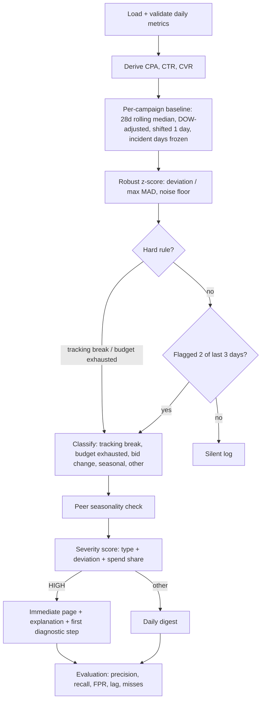

# PS-04: Campaign Anomaly Alerting Without Alert Fatigue — Final Implementation Plan

## 0. How the two source plans compare

| Dimension | Plan A (`PS-04_implementation_plan.md`) | Plan B (`PS04_WORKFLOW_AND_REFINEMENTS.md`) | Winner / decision |
|---|---|---|---|
| Nature | Standalone, runnable plan with phases, time estimates, risks | Adaptation guide for an existing security-ops codebase | A as the backbone; B contributes architecture and schema ideas |
| Baseline | Rolling 28-day **median**, day-of-week adjusted, **shifted one day** | Rolling 14/30-day **mean + std** | **A.** Median/MAD resists past incidents; 28 days = 4 full weeks, so weekday effects cancel; shift avoids self-contamination |
| Volatility | MAD per campaign and metric | Std dev | **A** |
| Small-campaign handling | Poisson / binomial noise floor | Only stated as a goal ("$3 swing on $10/day") | **A** (actually implements it) |
| Slow-incident handling | 14-day incident freeze | None | **A** |
| Alert-fatigue control | Persistence (2 of 3 days) + hard-rule bypass | None explicit | **A** |
| ML model | None (pure statistics) | Isolation Forest + dynamic z-score | **Hybrid:** statistics are primary; Isolation Forest is an optional secondary signal (see 4.5). With ~20 campaigns x 180 days, an unsupervised global model adds little and is hard to explain |
| Seasonality | Peer-based: ≥40% of campaigns move together by >8% and campaign is back in range after removing market move | Day-of-week rules only | **A**, plus B's explicit "Seasonality / Normal Variance" digest stream label |
| Classification | 5 types incl. tracking break, budget exhausted, bid change | System issue vs seasonality (2 classes) | **A** |
| Explanations | Per-type template with metric, actual, expected, baseline | Good example narrative; JSON payload | **Merge:** A's templates, B's JSON payload shape |
| Input schema | `date, campaign, spend, clicks, conversions` | Adds `bid_strategy`, CPA | **Merge:** keep A's required columns, accept B's `bid_strategy` as optional and derive CPA/CTR/CVR |
| Evaluation | Recall, precision (overall + pages), FP/month, detection lag, threshold sweep | Precision, recall, FPR, missed incidents | **A**, plus B's confusion matrix and an explicit FPR definition |
| Visuals | Optional plots | Mermaid workflow | **Merge:** keep both |
| Risks | Table with mitigations | None | **A** |
| Weaknesses | Doesn't use `bid_strategy` column when present; no cross-metric rule spelled out | Mean/std baseline contaminated by incidents; "Infosys cybersecurity" framing and file paths are irrelevant to a clean submission; no freeze/persistence | — |

**Verdict:** Plan A is statistically stronger and submission-ready. The final plan keeps A's engine and adds four things from B: the optional `bid_strategy` field, an explicit alert JSON payload, a confusion matrix with a defined false-positive rate, and an optional Isolation Forest cross-check. It also adds two improvements neither plan has (cross-metric tracking-break rule, and anti-overfitting validation).

---

## 1. Goal

Build an alerting system over daily campaign metrics that flags genuine anomalies, stays quiet otherwise, explains every alert in plain English with a first diagnostic step, and reports its own precision and recall against the seeded incidents, including the misses.

## 2. Pipeline



## 3. Components

| Component | Specification |
|---|---|
| Baseline | Rolling 28-day median per campaign and metric, day-of-week factor, computed on data shifted by 1 day |
| Volatility | MAD per campaign and metric (scaled by 1.4826 to be std-comparable) |
| Noise floor | Poisson floor for counts (clicks, conversions); binomial floor for CVR. Effective band = max(T x MAD, noise floor) |
| Incident freeze | Flagged days excluded from baseline for up to 14 days |
| Persistence | Alert when flagged on 2 of the last 3 days, unless a hard rule fires |
| Hard rules | (a) **Tracking break:** conversions = 0 for ≥2 days while clicks and spend stay within normal range, and expected conversions ≥ a volume guard. (b) **Budget exhausted:** spend drops to a cap pattern / clicks fall late-cycle with expected volume above guard. (c) **Bid strategy change:** if `bid_strategy` column exists, any change in value is a direct signal; otherwise infer from a joint shift in CPA and spend with stable clicks |
| Cross-metric logic | Combine metric directions: spend up + conversions down = tracking or efficiency break; spend down + clicks down = budget or delivery issue |
| Seasonality | Seasonal when ≥40% of campaigns move the same direction by >8% and the campaign's residual returns to range after removing the peer median move. Routed to digest stream "Seasonality / Normal Variance" |
| Severity | Score = type weight x deviation size x campaign spend share. HIGH pages; all else goes to digest |
| Explanation | Per-type template: metric, actual, expected, % change, baseline window, suspected cause, first diagnostic step |
| Optional ML | Isolation Forest on per-campaign standardized residuals, used only as a secondary signal for "other anomaly" (never to page by itself). Skip if time is short |

### 3.1 Alert payload (merged from both plans)

```json
{
  "campaign": "CMP-012",
  "date": "2026-03-15",
  "type": "tracking_break",
  "severity": "HIGH",
  "route": "immediate",
  "metric": "conversions",
  "actual": 0,
  "expected": 12.4,
  "delta_pct": -100,
  "baseline": "28-day median, weekday-adjusted",
  "explanation": "Conversions fell to 0 (expected ~12) for 2 days while clicks held steady at 340 (expected 335). Suspected broken conversion tracking.",
  "first_step": "Check the conversion tag and landing page snippet; test a conversion in preview mode."
}
```

## 4. Implementation steps

### Phase 1: Baseline run (~30 min)
1. Install deps: `pip install pandas numpy scikit-learn --break-system-packages` (scikit-learn only if using the optional ML signal).
2. Place `data.csv` and `incidents.csv` in the project folder.
3. Validate input: required columns `date, campaign, spend, clicks, conversions`; optional `bid_strategy`. Map aliases (`campaign_id`, `campaign_name`, `cost`, `conv`, `day`) in `load_real()`. Fail loudly on missing dates, duplicate campaign-days, or negatives.
4. Run `python anomaly_alerting.py data.csv incidents.csv`.
5. Confirm outputs: `alerts_all.csv`, `alerts_immediate.csv`, `digest.csv`, and that every alert has an explanation and first step.

### Phase 2: Tuning (~45 min)
1. Read the threshold sweep (T = 3 to 6). Pick T in the **flat region** of the sweep, not the single best value, to avoid overfitting to the seeded incidents.
2. For each seeded incident record: caught or missed, detection lag (days), assigned type.
3. For each non-matching alert decide: true false positive or unseeded real anomaly, with reasoning.
4. Confirm the seasonal shift is routed to the digest. If not, tune `PEER_DEV` (0.08) or `PEER_SHARE` (0.40).
5. Spot-check 2-3 messages per type: quoted numbers must match the source data.
6. **Robustness check:** re-run with baseline window 21 and 35 days and confirm recall and page count do not change much.

### Phase 3: Evaluation and reporting (~30 min)
Report:
1. **Headline:** total alerts over 180 days, split into pages vs digest.
2. **Metrics:** precision and recall overall and for pages only; false-positive pages per month; detection lag per incident.
3. **Confusion matrix** at campaign-day level (TP, FP, FN, TN) and **FPR = FP / (FP + TN)** on non-incident campaign-days. Note that incident-level recall (did we catch it at all) is the primary recall number.
4. **Missed incidents:** each with the likely reason (e.g. low volume, statistically thin signal).
5. **Method summary:** the components in section 3.
6. **Before/after:** alert count for a naive fixed rule (e.g. ±30% vs previous day) vs the final system. Show as a number and percent reduction.
7. **Limitations:** tiny campaigns on conversions; gradual drift absorbed before the freeze engages; seasonality detected via peers, not year-over-year history; the incident file is small so metrics have wide uncertainty.

### Phase 4: Optional polish
- Single daily digest message instead of per-item rows.
- Per-campaign plot: metric, baseline band, flagged day, incident window.
- Weekly aggregate view for the smallest campaigns.
- Optional Isolation Forest cross-check, reported separately so it never muddies the main numbers.

## 5. Acceptance checklist

- [ ] Script runs end-to-end on real data with no errors
- [ ] Input validation catches bad rows and column mismatches
- [ ] Every alert has plain-English explanation + first diagnostic step
- [ ] Total alert count reported (pages vs digest)
- [ ] Precision, recall, FPR, confusion matrix, detection lag computed vs seeded incidents
- [ ] Missed incidents listed with reasons
- [ ] Seasonal shift routed to digest, not paged
- [ ] Before/after alert count included
- [ ] T chosen from a flat sweep region; window-sensitivity check done
- [ ] Limitations stated honestly

## 6. Risks and mitigations

| Risk | Mitigation |
|---|---|
| Column names differ from aliases | Map them in `load_real()` first |
| Gradual incidents | Report lag; explain freeze and persistence trade-off |
| Too few conversions on small campaigns | Rely on zero-run rule + volume guard; state limitation |
| Seasonal shift mistaken for incident | Check peer share and residual z; tune `PEER_DEV`/`PEER_SHARE` |
| Tuning overfits the seeded incidents | Flat-region T, window-sensitivity check, report uncertainty |
| Zero values mistaken for noise or vice versa | Hard rules guarded by expected volume |
| Optional ML adds noise | Keep it secondary; drop if it raises FP count |

## 7. Deliverables

- `anomaly_alerting.py` (detection + evaluation)
- `alerts_all.csv`, `alerts_immediate.csv`, `digest.csv`
- `incidents.csv`
- Submission write-up covering Phase 3 (include the before/after table and confusion matrix)
- Optional: plots and the Mermaid workflow diagram above
