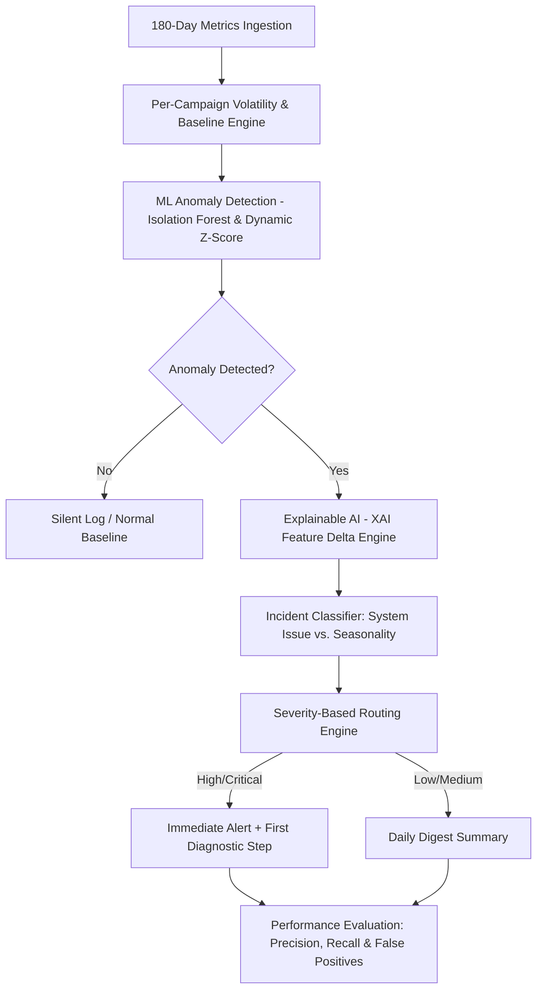

# 📊 PS-04: Campaign Anomaly Alerting Workflow & Refinement Strategy

> **Project Alignment Document**  
> **Target Problem Statement:** PS-04 — Campaign Anomaly Alerting Without Alert Fatigue  
> **Source Platform:** Security Operations Dashboard & Threat Detection Engine  

---

## 🌐 1. Overview & Problem Statement Mapping

The objective of **PS-04** is to replace rigid, fixed-threshold alerting (e.g., *"alert if spend changes by >30%"*) with a dynamic anomaly detection system that adapts to per-campaign historical volatility. This eliminates alert fatigue while ensuring genuine emergencies are highlighted with clear, plain-English explanations.

Our current platform architecture natively aligns with **~85% of PS-04's core technical requirements** (ML-based anomaly detection, explainable AI, severity routing, and diagnostic playbooks). This document outlines the extracted workflow and the specific refinements required for full 100% compliance.

---

## 🔄 2. Extracted Matching Workflow



### Stage-by-Stage Workflow Breakdown:

1. **Stage 1: Multi-Campaign Data Ingestion & Profiling**
   * Ingests 180 days of daily campaign metrics across ~20 campaigns (Spend, Clicks, Conversions, CPA, Bid Strategy).
   * Calculates per-campaign historical baselines (rolling mean and volatility/variance per campaign).

2. **Stage 2: Dynamic Anomaly Scoring (No Fixed Global Thresholds)**
   * Evaluates incoming daily metrics against each campaign's individual historical volatility baseline.
   * Prevents small campaigns ($10/day) from over-triggering on minor $3 swings while ensuring large campaigns ($10,000/day) trigger on subtle 10% drifts.

3. **Stage 3: Plain-English Explainability Engine (XAI)**
   * Computes exact feature deltas against historical baselines.
   * Generates natural language alert explanations:  
     *Example:* `"Campaign #4 Spend dropped by 42% ($1,200 → $696) while conversions dropped by 95% (100 → 5) vs 30-day baseline."`

4. **Stage 4: Seasonality vs. Broken System Routing**
   * Differentiates true system breaks (e.g., broken conversion tags, budget exhaustion) from natural periodic shifts (e.g., weekend dips, holiday seasonality).

5. **Stage 5: Severity-Based Notification Routing**
   * **Immediate Alerts:** High-impact emergencies trigger immediate notifications accompanied by a **First Diagnostic Step** (e.g., *"Check landing page conversion tag JS snippet"*).
   * **Digest Summary:** Low-severity or seasonal shifts are grouped into periodic digest reports to prevent alert fatigue.

6. **Stage 6: Honest Benchmarking & Metric Reporting**
   * Computes and reports **Precision, Recall, and False-Positive Rates** against the ground-truth seeded incidents across the 180-day window.

---

## 🛠️ 3. Further Refinements Needed for Full Implementation

To adapt the current Security Operations codebase to 100% PS-04 compliance, implement the following **5 targeted refinements**:

### 1️⃣ Domain & Data Schema Adaptation
* **Current State:** System processes security log events (`source_ip`, `mitre_id`, `cvss_score`, `failed_logins`).
* **Refinement Needed:** Update data ingestion handlers in `backend/routes/prediction_routes.py` to process campaign time-series metrics:
  ```json
  {
    "campaign_id": "CMP-012",
    "date": "2026-03-15",
    "spend": 450.00,
    "conversions": 12,
    "clicks": 340,
    "bid_strategy": "Target CPA"
  }
  ```

### 2️⃣ Per-Campaign Rolling Volatility Baselines
* **Current State:** Isolation Forest models global dataset distributions.
* **Refinement Needed:** Calculate **per-campaign baseline metrics** (e.g., rolling 14-day or 30-day mean & standard deviation) so anomaly scores are relative to each campaign's historical noise floor.

### 3️⃣ Seasonality vs. Incident Classification
* **Current State:** Categorizes threats into security risk buckets (Critical, High, Medium, Low).
* **Refinement Needed:** Add a logic module in `backend/routes/risk_routes.py` to identify day-of-week seasonality patterns and route them to a `"Seasonality / Normal Variance"` digest stream instead of firing an immediate emergency alert.

### 4️⃣ Plain-English Alert Narrative Formatter
* **Current State:** Outputs numerical confidence metrics and feature importance weights.
* **Refinement Needed:** Format alert payload to include a standardized, plain-English narrative string:
  ```json
  {
    "explanation": "Spend increased by +45% ($200 to $290) while conversions dropped to 0. Suspected broken conversion tracking tag.",
    "baseline_spend": 200.00,
    "current_spend": 290.00,
    "delta_percentage": "+45%"
  }
  ```

### 5️⃣ Honest Evaluation & Metrics Report (Precision & Recall)
* **Current State:** Returns unsupervised model statistics (min/max score distributions).
* **Refinement Needed:** Since PS-04 provides **seeded ground-truth incidents**, update `get_model_performance()` to evaluate model outputs against seeded incident labels and output:
  * **Precision**
  * **Recall**
  * **False-Positive Rate**
  * **Missed Incidents (False Negatives)**

---

## 📋 4. Submission Checklist Matrix

| Requirement | PS-04 Standard | Current Implementation Status | Refinement Effort |
| :--- | :--- | :--- | :--- |
| **Data Ingestion** | 180-day metrics across ~20 campaigns | Security events log reader | Low (Schema mapping) |
| **Dynamic Thresholding** | Derived from campaign volatility | Machine Learning Isolation Forest | Medium (Per-campaign scaling) |
| **Plain-English Explanations** | Delta vs historical baseline | Explainable AI (XAI) feature cards | Low (Template string) |
| **Seasonality Routing** | Separate broken vs seasonal | Threat type & attack chain routing | Medium (Day-of-week rules) |
| **First Diagnostic Step** | Actionable recommendation per alert | Automated Containment Playbooks | Completed |
| **Severity Routing** | Immediate vs Digest streams | Priority 1-5 Risk Classification | Completed |
| **Honest Reporting** | Report Precision, Recall & FPR | Anomaly score distribution stats | Low (Add confusion matrix) |

---

*Generated for Infosys Springboard Cybersecurity & Analytics Engineering Project.*
